# ComfyUI-FunPack v5 "Cunning Cranberry"

**FunPack v5 is here. It is a browser studio for video inside ComfyUI: a timeline with one clip per scene, a Composer for your prompts, pipeline cards instead of graphs, and modules that learn from your ratings - all on the regular ComfyUI backend.**

  &nbsp;
  &nbsp;
  

> [!IMPORTANT]
> FunPack is an open-source hobby project maintained by single person, available to you for zero cost. It means resources such as time and money are limited, and there is no "QA team" to review every single feature and report every bug.
> If you discover a bug or wish to suggest a new feature, feel free to open a new issue in this repo's Issues.

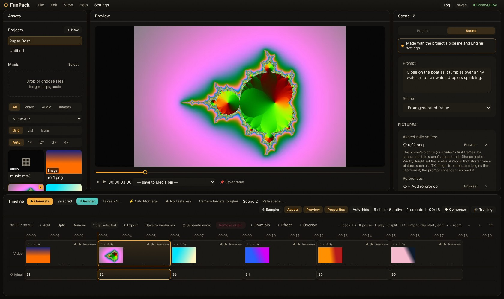

## What v5 is

A rewrite from scratch, not an update of 4.x. Every feature is a module that announces itself, so nothing can be forgotten in the UI, no wire can be missed, and a module that fails to load is simply left out while the run carries on. Open it at `/funpack/` in your browser.

- **Timeline studio**: one clip per scene, media bin, preview, takes, rating, Export, Render, a project wizard and a guided tour.
- **Composer**: write the story in one box, with a cut word, templates, `$variables` and shortcuts.
- **Models & Pipeline**: the pipeline as cards, not a graph. Pick files, swap or add nodes (any installed custom node), wire outputs to inputs, import a ComfyUI workflow. The server refuses what would not build and says why.
- **Modules**: switch each feature on or off in Settings. A pipeline runs without an optional node whose module is missing, and tells you so.
- **Learning from ratings**: rate a clip and the guidance, steering and prompt modules start acting on your taste once they have enough ratings.
- **Auto Montage**: builds a new cut from your rendered clips; the originals stay untouched.

The full list of features, and what is proven and what is experimental, is in [CHANGELOG.md](CHANGELOG.md).

## A look around

Every picture below is the real app, shown with an abstract demo project (clips made with ffmpeg, no model output).

### Write the story once

Composer holds the whole story in one box. A cut word splits it into scenes, `$variables` fill in what repeats, and templates and shortcuts keep your own wording close. The optional Enhance tab has a language model polish each prompt.

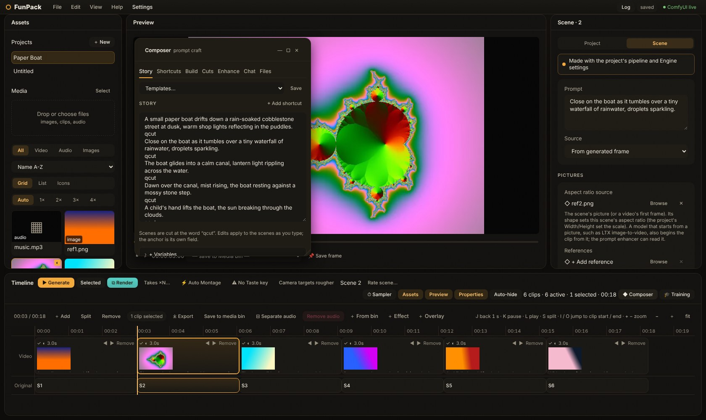

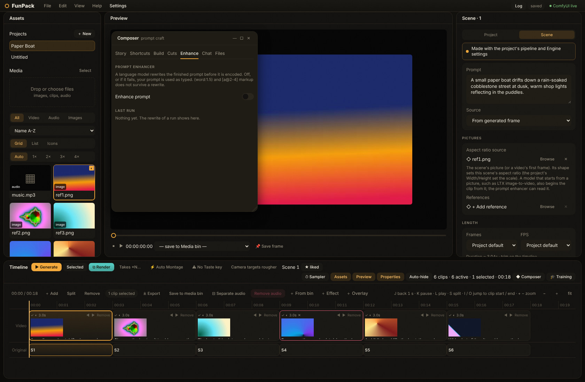

### Start a project in three steps

The Project Setup Wizard picks your look, names the project and loads the pipeline of the model you will use. No tabs, one step at a time.

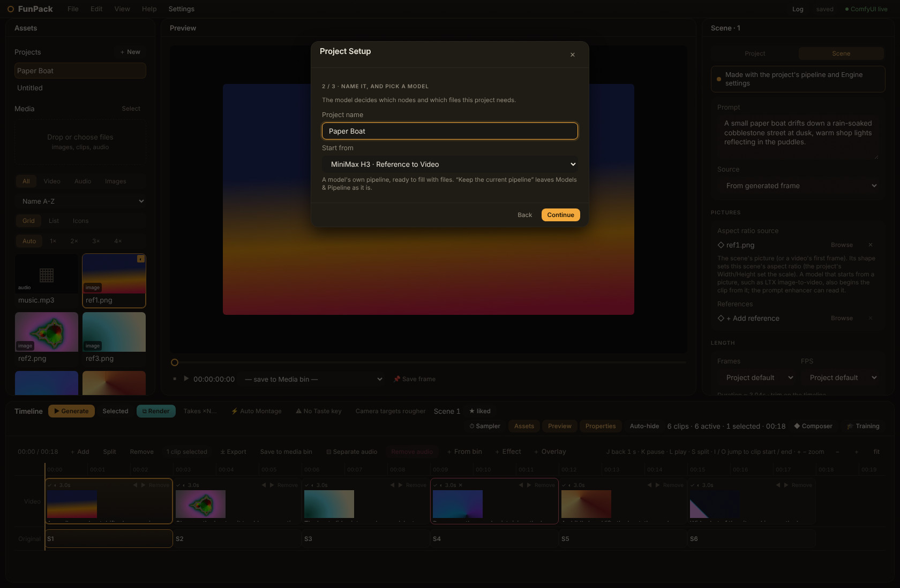

### Pipeline as cards, not a graph

Pick a file in each card, swap or add nodes, import a ComfyUI workflow. FunPack says when every slot is filled and names the first thing missing when it is not.

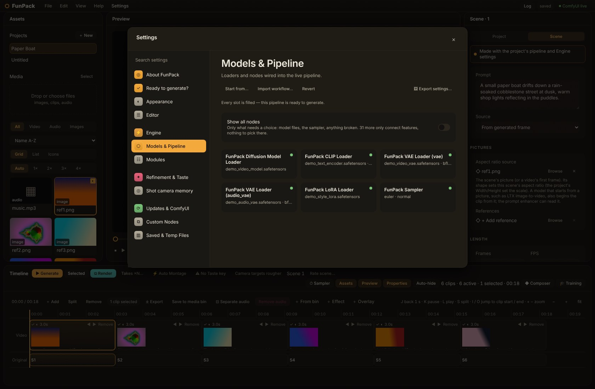

### Every module, one place

Modules announce their own settings, so Engine settings is always complete. Turn any module on or off in Settings > Modules.

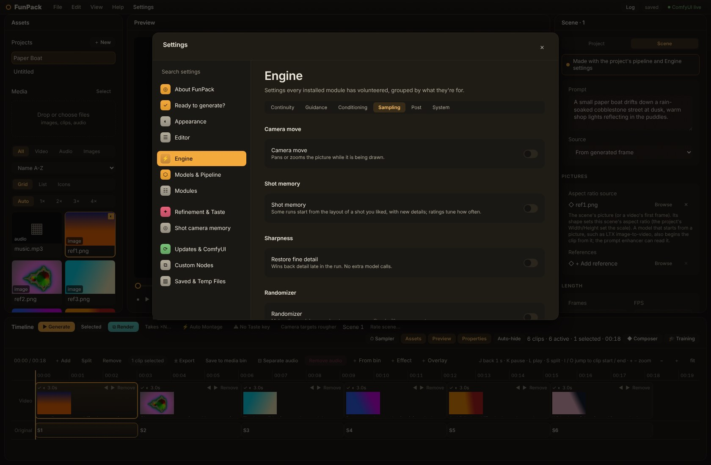

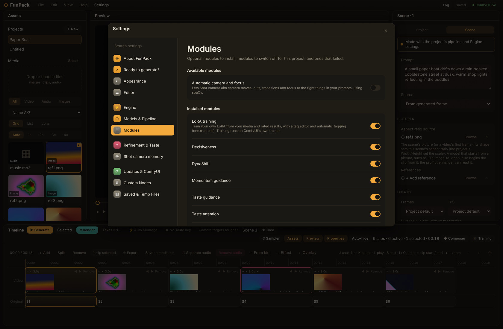

### Quick sampler settings

Steps, sampler, scheduler, seed and the common switches are one click away from the timeline, without leaving the clip you are working on.

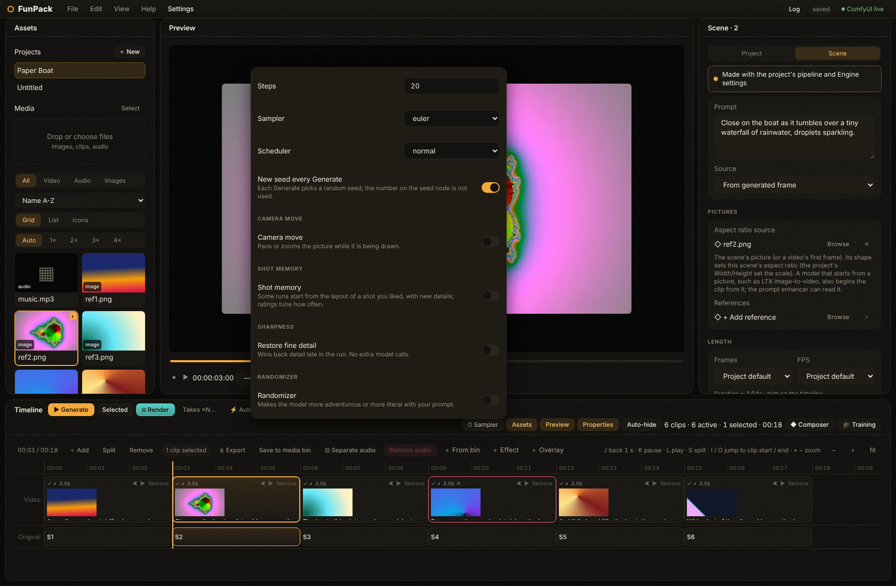

### Picker wheel

Press the middle mouse button anywhere and your most used actions fan out under the pointer. Release on one to run it. Which actions appear is up to you.

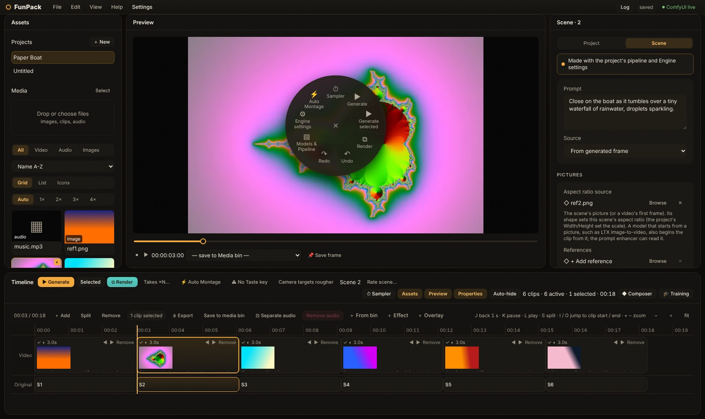

### Auto Montage

Builds a new cut at the end of the timeline from your rendered clips. The originals stay as they are.

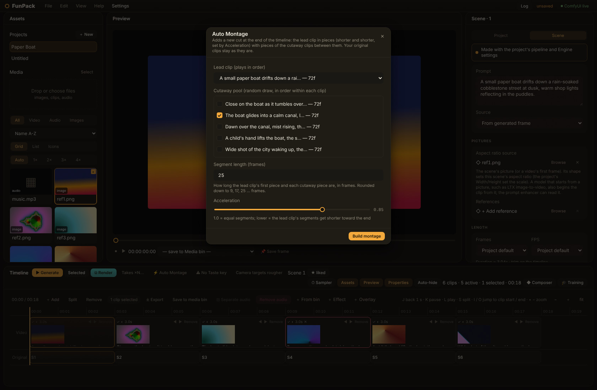

### Train your own LoRA (add-on)

Teach the model your style from your own media and results you rated. Pick the data, describe each item, press Start. It is an add-on you switch on in Settings > Modules, and it has been run on MiniMax H3 only.

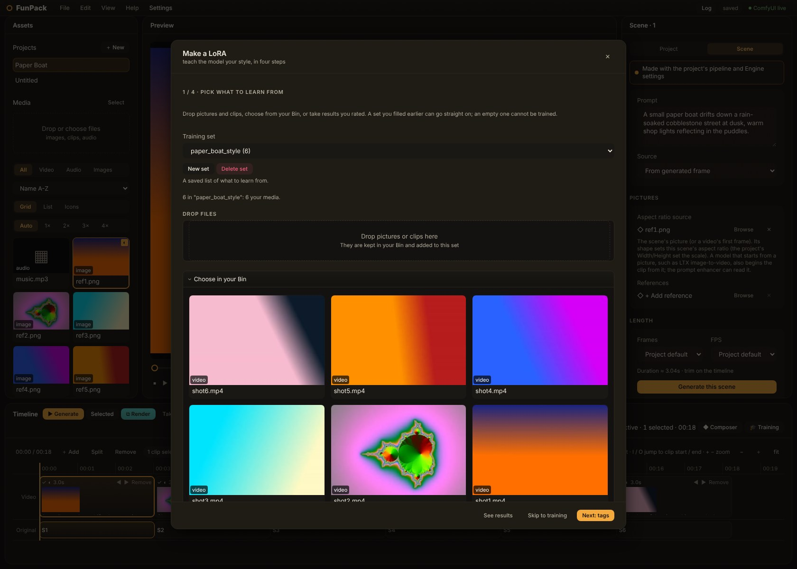

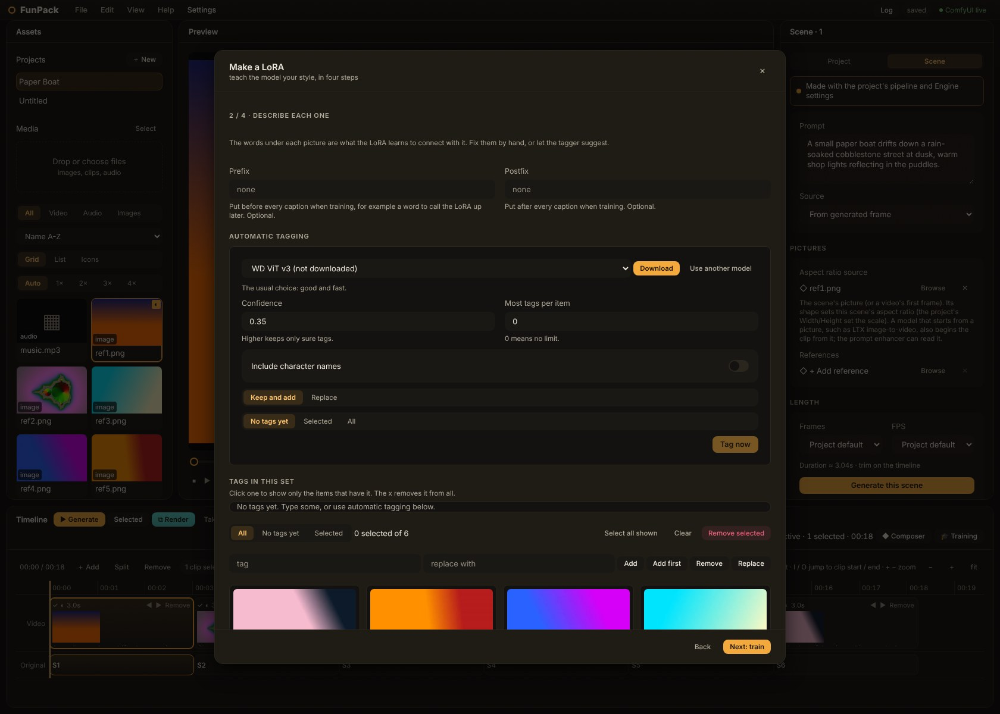

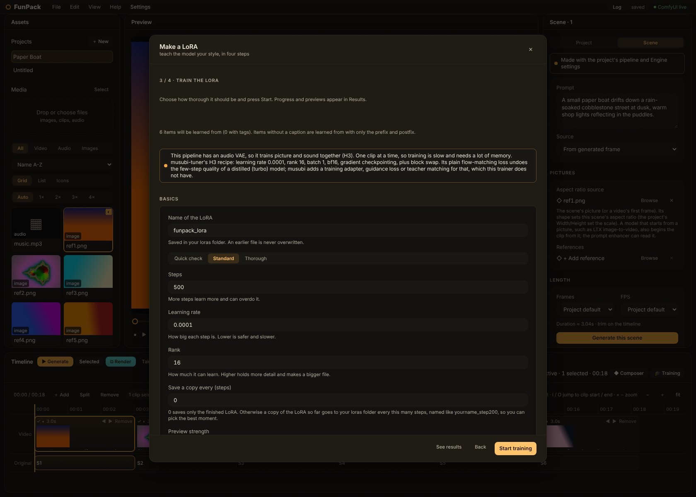

### Dark or light

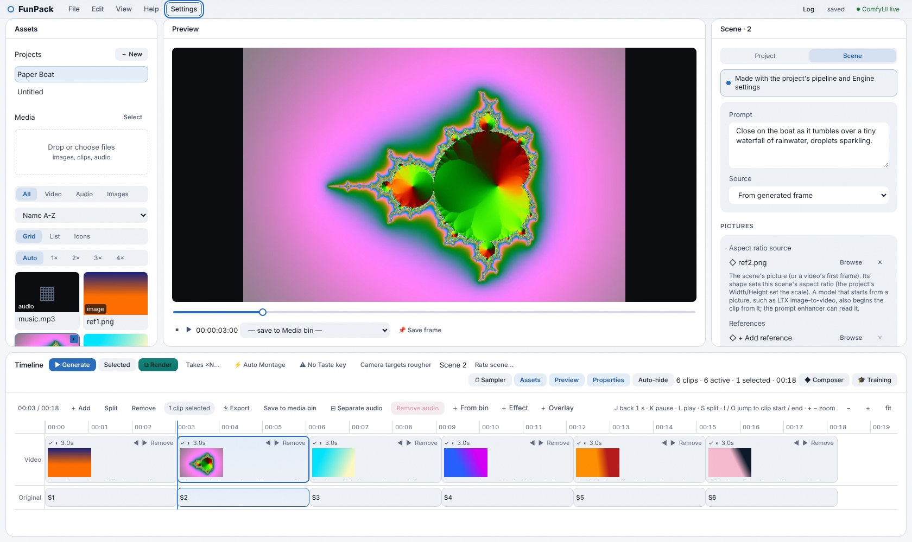

## Installation

With git, inside your `ComfyUI/custom_nodes` directory:

`git clone https://github.com/digital-garbage/ComfyUI-FunPack`

`comfy-cli` (`comfy node install ComfyUI-FunPack`) and ComfyUI-Manager install what is published on Comfy Registry. They give you 5.0 only once it is published there: check Settings > About FunPack after installing.

## Dependencies

FunPack includes a [`requirements.txt`](requirements.txt) file for its Python dependencies.

Install them with:

`pip install -r requirements.txt`

FunPack uses your existing ComfyUI/PyTorch install.

## Models

- **MiniMax H3**: the model v5 is built and tested around.
- **Stable Diffusion 1.5**: experimental.
- **LTX 2.x**: **UNTESTED.** It has never been run on a real LTX model and nobody plans to test it soon. You are free to try it; if you hit problems, please report them in Issues.

## Documentation

Start with [How to start generating with FunPack](docs/how-to-start.md). The app also has a guided tour: Help -> Start tour.

Writing a module or a UI feature? Start with [Developing FunPack](docs/README.md).

Version history is available in [CHANGELOG.md](CHANGELOG.md).

## Classic FunPack (4.x)

FunPack 4 was a different app: Cutting Room, with Easy Gen as its simple mode, and no modules. It is no longer developed, but it is kept for anyone who prefers it: `git clone -b v4-classic https://github.com/digital-garbage/ComfyUI-FunPack`, or browse the [`v4-classic`](https://github.com/digital-garbage/ComfyUI-FunPack/tree/v4-classic) branch.

## Feedback

If you have suggestions, questions, or ideas for new features, feel free to open an issue or submit a pull request.

## Intent

FunPack is provided under GNU General Public License V3, which gives you broad rights to use, modify and distribute the original/modified version of it as long as the original license text is included. FunPack places no limitations on types of content you can generate by using it, meaning both SFW and NSFW content are fine as long as you don't violate your local laws. GPLv3 does not grant you rights for such violations.

However, I do not endorse using FunPack and/or demonstrating it alongside morally and legally questionable/prohibited content, including:
- Non-consensual explicit depiction of a real person;
- Explicit depiction of minors;
- Depiction of violence and gore targeted at a real person.

I do not provide support to users who use FunPack in such cases, and in case I detect it, any support will be immediately ceased.

Thanks for understanding.

## Thank you

I express my deepest gratitude to:

- OpenAI and ChatGPT Codex;
- xAI and Grok Build;
- Anthropic and Claude Code;
- Team Cursor and Composer model;
- DeepSeek team and model;
- Google and Gemini;
- Lightricks and the LTX-Video model; FunPack's identity-transfer phase tag is a port of `ltx_core` (Apache-2.0);
- [ComfyUI-LTXVideo](https://github.com/Lightricks/ComfyUI-LTXVideo) — the LTX nodes used by the LTX pipeline presets;
- [ComfyUI-KJNodes](https://github.com/kijai/ComfyUI-KJNodes) — utility nodes used by the H3 pipeline presets;
- [ComfyUI-GGUF](https://github.com/city96/ComfyUI-GGUF) — reads quantized `.gguf` encoders when it is installed;
- ComfyUI-H3-SLA-Attention (MIT) — the SLA block-sparse attention for MiniMax H3 is ported from it, and its kernel and block map come from [LightX2V](https://github.com/ModelTC/LightX2V) (Apache-2.0);
- ComfyUI-MiniMaxH3_LatentUpscaler by Tr1dae — the tiled H3 decode and the X2 Detail VAE output handling are ported from its "VAE Decode (fast)";
- the authors of the papers behind the sampling modules: ALG (arXiv 2506.08456), FreeSliders (2511.00103), Decisiveness (2510.01184), momentum (2602.20360), "Pulling The REINS" (2606.17257) and STAS (2603.17825);
- [OpenCut](https://github.com/opencut-app/opencut-classic) — the in-browser non-linear video editor whose UI and interaction patterns inspired FunPack's timeline studio;
- [Inter](https://github.com/rsms/inter) and IBM Plex Mono — the fonts of the app (SIL Open Font License; copies in `app/assets/fonts`);
- [musubi-tuner](https://github.com/kohya-ss/musubi-tuner) by kohya-ss (Apache-2.0) — the LoRA training add-on's loop (which layers get a LoRA, per-block checkpointing, noise sampling and loss weighting, optimizer and learning rate) and its block swap (a number of transformer blocks kept in system memory) follow its MiniMax H3 training recipe;
- PTD few-step support for MiniMax H3 is ported from [ComfyUI-PTD-Compact](https://github.com/Nynxz/ComfyUI-PTD-Compact) by Nynxz (Apache-2.0), which builds on [ComfyUI-PTD](https://github.com/vita-epfl/PTD-inference) by EPFL VITA Lab (Apache-2.0; paper "Parametric Trajectory Distillation for Few-Step Video Generation", arXiv 2610.11498) and on ComfyUI-MiniMaxH3-PTD by taobao-content-ai (Apache-2.0); licence notice in `modules/sampling/ptd`;
- ComfyUI and its whole community.

Without all of you, this project would've been impossible.

With <3

DigitalGarbage
